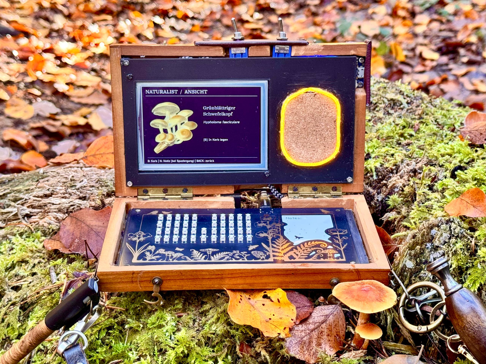
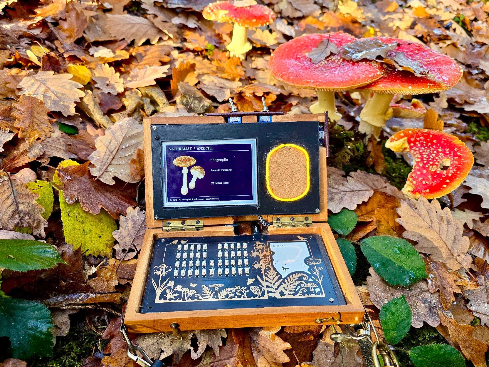
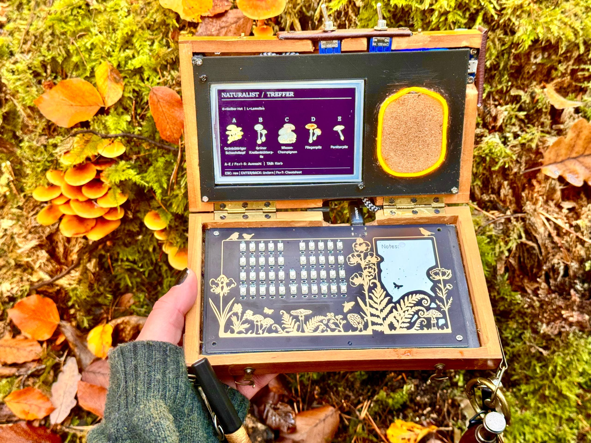

# The Naturalist

*A cyberdeck for the curious wanderer.*

The Naturalist is a tiny field computer built into a flea-market pencil case and designed to resemble the antique measuring instruments I collect. It features a Raspberry Pi Zero 2 W, a six-colour eInk display, a custom RP2040-based keyboard, and some aesthetically pleasing scavenged loot.

Its interior is inspired by old field guides and journals, and its first job is to accompany me into the woods as an offline mushroom field guide. The Naturalist is deliberately built around slowness and meant as an invitation to observe (and not just because the eInk takes up to 30 seconds to refresh!).

I enter a few mushroom characteristics using keyboard shortcuts, and my *Pilzapparat* (= mushroom apparatus) presents a handful of illustrated suggestions to browse and select for my virtual mushroom basket. It's a tool for exploration and not a food-safe mushroom guide (please do not base your decision which mushroom to lick on my database...).

And the illustrations aren't just random pictures. They're very much the point: I hand-selected them from the Biodiversity Heritage Library because I love the thought of a naturalist meticulously painting a mushroom 150 years ago, only for a weird woman to marvel at it on a 4-inch eInk display today. I'd love to add pages about the artists and naturalists in a future release, once I've sorted out the relevant rights and attribution details.

There's no cloud, no AI, or anything of the sort, simply because the process of hand-picking, marvelling, and observing is what makes this fun for me.

## Features

- Raspberry Pi Zero 2 W with a six-colour eInk display
- Custom RP2040-based, 42-key keyboard with a fancy ENIG finish
- Offline mushroom database and trait vocabulary
- Shortcut- and score-based search for illustrated mushroom candidates
- Virtual mushroom basket for collecting finds

## Repository Structure

    hardware/        KiCad PCB design, manufacturing files and artwork
      qmk/           QMK firmware for the Naturalist keyboard
    software/        Naturalist application software and assets
      data/          JSON data for mushrooms, traits and shortcuts
      assets/        Original and prepared mushroom illustrations
    pictures/        Naturalist glamour shots (and some less glamorous ones, too)

Detailed documentation lives in the relevant directories:

- [Hardware](hardware/README.md)
- [Keyboard firmware](hardware/qmk/keyboards/naturalist/README.md)
- [Software](software/README.md)

## Project Background

As usual with my personal projects, the Naturalist merges a few of my passions and preferences and, in doing so, "solves" problems that are probably uniquely mine. In this case: unusual computers, antique instruments, nature, and a somewhat odd lifelong obsession with mushrooms (I'm not exaggerating; I have proof ;)).

It started with a very simple idea back in March 2026, when I acquired a "new" antique ammeter for my collection and wondered how wonderful it would be to build a small computer into an antique measuring instrument. Luckily, not even I could bring myself to butcher an actual instrument. Then I found an antique wooden pencil case at a flea market, and the problem solved itself.

So what unique problem of mine does it actually solve? Well, it lets me collect things and turn them into little pieces of art without having to remove anything from the forest. And I get to indulge in some special-interest knowledge along the way.

For now, that means mushrooms. Eventually, I'd love to expand it to plants, minerals, maybe even birdsong (tho I'm really not a bird person ... yet ...).

One more thing about how I work on personal projects: I had the idea in March, designed the hardware in August and September, and took the Naturalist on its first mushroom walk in November. I often get questions on social media about when firmware or software will be available, but please remember that these are hobby projects. I'm always delighted when other people enjoy the same weirdness I do, but I work a full-time job, and this is a one-woman endeavour. If you're waiting for a release, think months, not days or weeks.

## Licenses

- **Hardware:** CERN-OHL-S v2
- **Data and illustrations:** The curated mushroom data is intended for release under CC0. Historical illustrations have their own provenance and rights information; please check the respective assets rather than assuming that one license covers everything.
