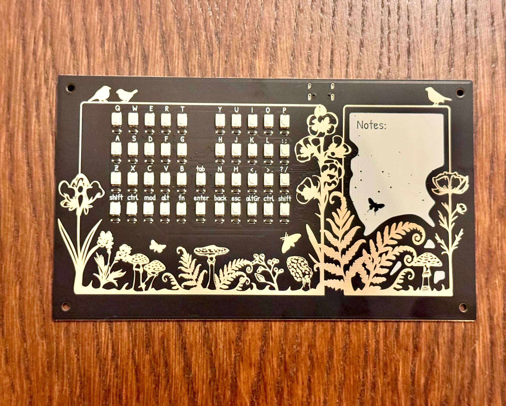
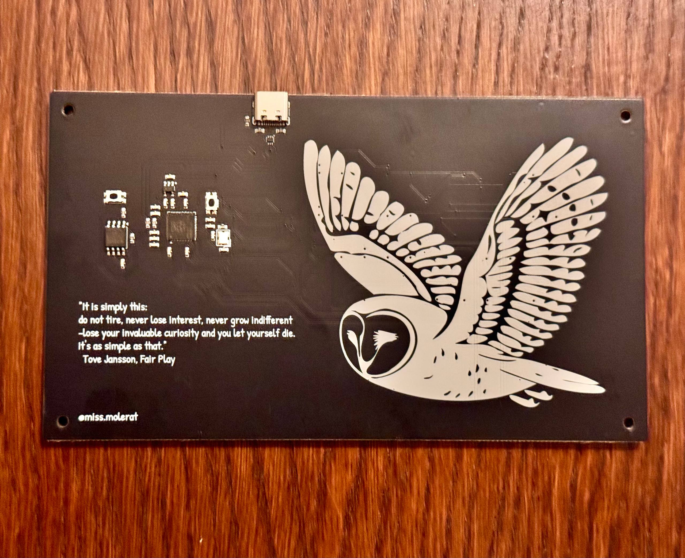
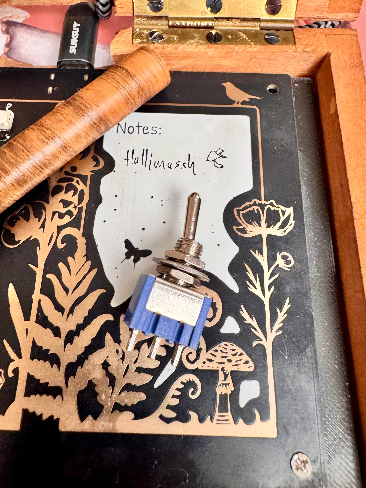

# The Naturalist Hardware

Hardware desgin and fabrication files for [The Naturalist Cyberdeck](../README.md), currently that's just the Naturalist keyboard. For my next PCB order, there's also a cover plate with integrated LiPo charger and USB ports planned, which will live here, too.

The Naturalist keyboard is a 42-key, RP2040-based board that uses small pushbuttons instead of switches, with a USB-C connector, it has a little silkscreen area for notes with a erasable marker.

## Hardware Overview

To build The Naturalist exactly as shown in the pics, you'll need:

- a wooden case with internal dimensions of at least 16 × 10 cm and a depth of at least 1.6 cm
- a Raspberry Pi Zero 2 W
- a Pimoroni Inky Impression 4-inch Spectra 6 display
- an Adafruit Power Boost 1000C
- a LiPo battery (ideally at least 2000 mAh)
- a warm white LED noodle
- two toggle switches (one for power, one for the light)
- the Naturalist keyboard (see design files here and its BOM)
- the 3D printed parts (see `STL/`)
- brass picture hangers and a leather strap if you want to wear it as a purse
- some (faux) leather for decoration
- a small piece of corkboard

Keep in mind that mine lives in a flea-market pencil case and the 3D-printed parts and mounting positions may need some adjustments to fit yours.

## Directory Structure

The KiCad keyboard design files are in this directory. The other files are organized as follows:

    fabrication/    Gerber files, a ready and tested Gerber ZIP, and PCB assembly files
    qmk/            QMK keyboard firmware files
    STL/           3D-printable covers and mounting parts
    libraries/      Project-specific KiCad symbols and footprints

## Manufacturing of the keyboard

The `fabrication/` directory contains a zipped set of Gerbers that was manufactured and tested. 
You can upload this ZIP to a PCB manufacturer, or regenerate the Gerbers from the KiCad project.

The same directory also includes a BOM and placement files for JLCPCB assembly if you want the board populated for you (not an ad, I just like to order there because I'm impatient, and they're the fastest for my location in my experience).

### Keyboard BOM

Just a quick overview, see `fabrication/` for manufacturing BOMs

<table>
  <thead>
    <tr><th align="right">Qty</th><th>Component</th><th>Description</th></tr>
  </thead>
  <tbody>
    <tr><td align="right">1</td><td>RP2040</td><td>Microcontroller</td></tr>
    <tr><td align="right">1</td><td>W25Q128JVSIQ</td><td>128 Mbit QSPI Flash</td></tr>
    <tr><td align="right">1</td><td>ABM8-272-T3</td><td>12 MHz crystal</td></tr>
    <tr><td align="right">1</td><td>AP2112K-3.3TRG1</td><td>3.3 V voltage regulator</td></tr>
    <tr><td align="right">1</td><td>USB4105-GF-A</td><td>USB-C connector</td></tr>
    <tr><td align="right">1</td><td>USBLC6-2P6</td><td>USB ESD protection</td></tr>
    <tr><td align="right">42</td><td>1N4148WS</td><td>Switching diodes, SOD-323</td></tr>
    <tr><td align="right">42</td><td>TS-1188U-C</td><td>Keyboard switches</td></tr>
    <tr><td align="right">2</td><td>KMR221G-LFS</td><td>BOOTSEL and RESET buttons</td></tr>
    <tr><td align="right">11</td><td>100 nF</td><td>Capacitors, 0603</td></tr>
    <tr><td align="right">4</td><td>1 µF</td><td>Capacitors, 0603</td></tr>
    <tr><td align="right">2</td><td>15 pF</td><td>Capacitors, 0603</td></tr>
    <tr><td align="right">2</td><td>1 kΩ</td><td>Resistors, 0603</td></tr>
    <tr><td align="right">2</td><td>5.1 kΩ</td><td>Resistors, 0603</td></tr>
    <tr><td align="right">1</td><td>10 kΩ</td><td>Resistor, 0603</td></tr>
    <tr><td align="right">1</td><td>0 Ω</td><td>Resistor, 0603</td></tr>
    <tr><td align="right">2</td><td>27 Ω</td><td>Resistors, 0603</td></tr>
  </tbody>
</table>

### Keyboard Firmware

See [QMK README](./qmk/keyboards/naturalist/README.md)

## License

The keyboard hardware design is licensed under the **CERN Open Hardware Licence Version 2 – Strongly Reciprocal (CERN-OHL-S v2)**.

You may manufacture, modify, and sell products based on this design, subject to the conditions of the license, including its requirements for sharing modified design sources when applicable.

The full license text is in the `LICENSE` file. Other components, software, and third-party parts have their own licensing terms.
