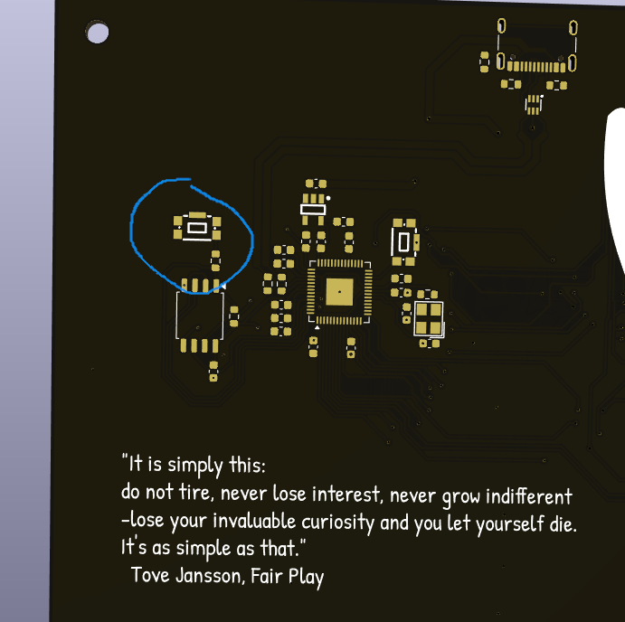

# Naturalist

A 42-key custom RP2040-based keyboard for the [Naturalist Cyberdeck](../../../../README.md).

- **Maintainer:** [kati](https://github.com/bitshiftcrazy)
- **Hardware:** Custom Naturalist RP2040 PCB
- **Matrix direction:** ROW2COL
- **Firmware:** QMK

## Building and Flashing

Place the `naturalist/` keyboard directory inside your QMK firmware checkout under `keyboards/`.

Compile the default keymap:

    qmk compile -kb naturalist -km default

Flash the keyboard:

    qmk flash -kb naturalist -km default

## Bootloader

Enter the RP2040 bootloader by holding BOOTSEL while connecting USB (when holding the keyboard with the back up, BOOTSEL is the button closer to the left edge).

Then copy the compiled `.uf2` firmware file onto the `RPI-RP2` USB device.

## Directory Structure

    keyboards/
      naturalist/
        keyboard.json
        rules.mk
        README.md
        keymaps/
          default/
            keymap.c
