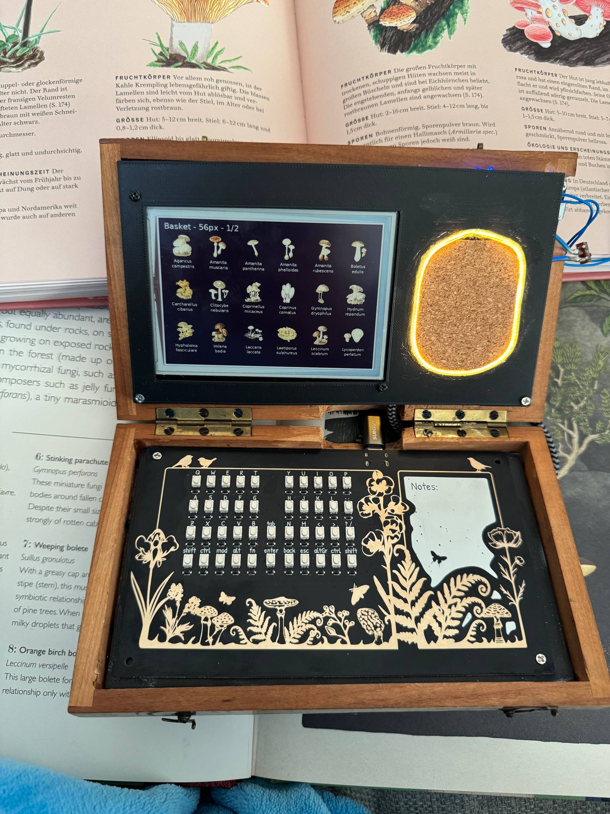

# The Naturalist Application Software

Software for [The Naturalist Cyberdeck](../README.md): an offline, illustrated mushroom exploration apparatus.

Currently implemented and published (and superficially tested ;)) features:
- shortcut- and score-based search for illustrated mushrooms (deliberately no autmated identification, don't let machines take all the fun)
- mushroom database and illustrations for 25 common mushrooms (in Germany)
- trait vocabulary and keyboard shortcuts
- navigation between search, cheatsheet, help, results, individual mushrooms and basket
- mushroom walks with start/end times + location
- persistent mushroom baskets for these walks (basket content saved automatically as JSON)
- basic note taking for walks/finds (as much as an eInk allows...)
- basic English support (I'm German and hacked that in last minute so expect some creative wording)

## Hardware Requirements

For the exact build, see [the hardware documentation](../hardware/README.md).

If you want to generalise for your own deck, the software currently expects:

- a Linux computer (developed on a Raspberry Pi Zero 2 W running Raspberry Pi OS Lite, but other SBCs/Rasberry Pis should do, too)
- a Pimoroni Inky Impression 4-inch **Spectra 6**, with a **600 × 400** display, the rendering and Python bridge are written for this resolution
- an evdev keyboard, the default device search looks for the Naturalist's QMK keyboard under the name `kati naturalist` (NOT kati naturalist keyboard because reasons)

A different keyboard can be used with `--device /dev/input/eventN`, if its key events match the application's shortcuts. A different display would need changes to the renderer and display bridge, simply attaching another eInk panel probably isn't enough.

## Software Requirements

Install a Linux distro of your choice on your Pi, the steps here assume Pi OS Lite
For the C software, install GCC/Make, `pkg-config`, and Jansson and PangoCairo. 
On a Debian-based installation:

    sudo apt update
    sudo apt install build-essential pkg-config libjansson-dev \
        libcairo2-dev libpango1.0-dev python3 python3-venv git

The display script, [`display/inky_bridge.py`](display/inky_bridge.py), requires **Pimoroni's `inky` Python library** and **Pillow**. It uses `inky.auto` to find the attached display.

I use Pimoroni's virtual environment at `~/.virtualenvs/pimoroni`. 
For a new installation, pls follow [Pimoroni's Inky installation instructions](https://github.com/pimoroni/inky#installation) (including enabling the Pi's required hardware interfaces). 
Their installer sets up Python dependencies and virtual environment, the current instructions there recommend Raspberry Pi OS Bookworm or newer. My deck was built with Bullseye Lite.

### Fonts

The renderer also expects these fonts:

- [IBM Plex Serif](https://github.com/IBM/plex) (SemiBold) for headings
- [Atkinson Hyperlegible Next](https://github.com/googlefonts/atkinson-hyperlegible-next) (Medium) for body text

The font files are **not bundled** in this repository. You need to install them or Pango will certainly find the ugliest default font on your system and use this instead.
Either install them via your distro, or manually:

    mkdir -p ~/.local/share/fonts
    cp IBMPlexSerif-SemiBold.ttf ~/.local/share/fonts/
    cp AtkinsonHyperlegibleNext-Medium.ttf ~/.local/share/fonts/
    fc-cache -f

And verify:

    fc-match "IBM Plex Serif"
    fc-match "Atkinson Hyperlegible Next"

Make sure you install them as the user that also runs the Naturalist systemd service.

## Building the software

Clone this repo to your machine, from `software/` do:

    make

This creates `build/naturalist-deck` 
Use `make clean` to remove the build dir.

To run it on your deck,  from `software/` as well:

    ./build/naturalist-deck \
        --python "$HOME/.virtualenvs/pimoroni/bin/python" \
        --live

The code expects `data/`, `assets/` and `display/` relative to where you run it unless you override those paths. 
It also needs permission to read the keyboard's `/dev/input/event*` device and access the connected Inky display.

Options (all go **before** `--live`):

- `--data DIR`  mushroom, trait and shortcut JSON files (default: `./data`)
- `--assets-root DIR`  root for illustration paths (default: `.`)
- `--device PATH` specific evdev input device (default: auto-detect `kati naturalist`)
- `--python PATH`  Python interpreter for the display bridge (default: `python3`)
- `--bridge PATH`  display bridge script (default: `./display/inky_bridge.py`)
- `--frame PATH`  generated image passed to the bridge (default: `/tmp/naturalist-frame.png`)
- `--walk-dir DIR`  directory for saved walks (default: `~/.local/share/naturalist/walks`)

You can also run `./build/naturalist-deck --help` to print these options.

## Starting Automatically with systemd

You'll find a service template at [`systemd/naturalist-deck.service`](systemd/naturalist-deck.service). **It currently contains my own username and absolute paths**, you'll need to edit this (unless you're kati, too, that is) `User=`, `WorkingDirectory=` and `ExecStart=` for your installation before enabling it.
`ExecStart=` needs to point to the built executable and the Python interpreter for `inky`.

For the system-wide service, from `software/`:

    sudo cp systemd/naturalist-deck.service /etc/systemd/system/
    sudoedit /etc/systemd/system/naturalist-deck.service
    sudo systemctl daemon-reload
    sudo systemctl enable --now naturalist-deck.service

Check it with:

    systemctl status naturalist-deck.service
    journalctl -u naturalist-deck.service -b

The service runs under the configured user, that means your user needs access to the input device, the display hardware, the files and the walks directory.

And:
the `Ctrl+Alt+P` poweroff shortcut may need permissions, too: 
the program calls `sudo -n /usr/bin/systemctl poweroff`, which of course won't work without your sudoers password if you don't configure it to do.
You may want to update your sudoers or change that shortcut, that's up to you.

## Configuration

Right now the only (highly sophisticated) way to configure your language is to comment/uncomment the defines in [`include/renderer.h`](include/renderer.h):

    //#define NTRLST_LANG_DE
    #define NTRLST_LANG_EN

Enable just one! (I know, I know...it's temporary, okay? ;))

Walks are saved outside the repository by default, under `~/.local/share/naturalist/walks/` (or under `$XDG_DATA_HOME/naturalist/walks/` when that variable is set). An active walk uses `active.json`, ending a walk archives it as a JSON file.

## Keyboard Software

The keyboard runs QMK firmware; see [the keyboard firmware directory](../hardware/qmk/keyboards/naturalist/README.md).

## What's next

Next planned steps are:
- implement proper localisation
- more mushroom species (see [data README](../software/data/README.md) if you'd like to contribute or add your own species)
- eventually other observable things like plants, minerals, frogs...

And: I plan to add information pages for both the artists and the mushrooms. So far I have copied that info for private use from online mushroom guides. But to publish this, I need to check right, attribution and sources properly. That simply takes a bit.
